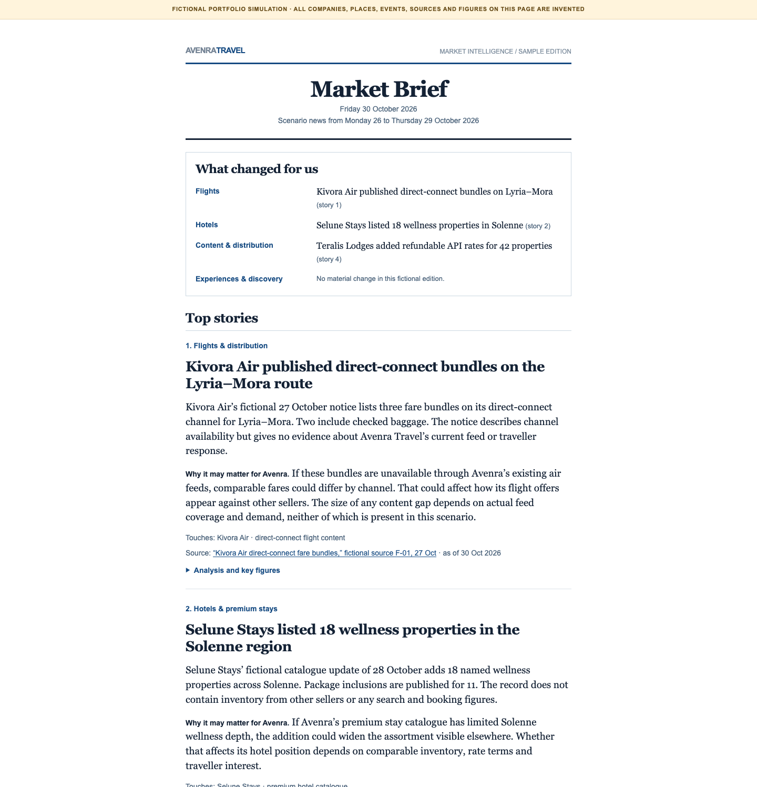
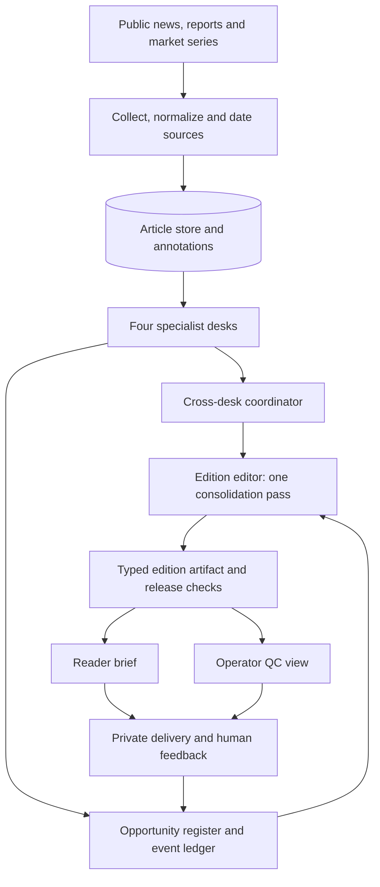

# Travel Market Intelligence for OTAs

**An architecture case study and runnable, fictional sample of an evidence-led travel intelligence system.** It turns public market developments into a short brief with traceable facts and conditional hypotheses for a multi-product online travel agency (OTA).



> **Portfolio disclosure:** Avenra Travel, the continent of Caelora, every supplier, event, number and source record in the sample are invented. The system described here is adapted from a separate private project. This repository is a shareable reference slice, not that project's source code, live pipeline, client data or measured business results.

## Why an OTA would use this

An OTA has to understand flight capacity and distribution, hotel supply, destination discovery and market inputs together. A news feed presents many facts, but leaves the reader to work out which ones touch their product catalogue and what remains uncertain. This system is designed to produce a brief that answers three questions:

1. **What changed?** A factual headline tied to a dated source.
2. **Why might it matter?** A conditional chain from a market change to a specific OTA product line.
3. **What evidence is missing?** The conditions that could strengthen or weaken the hypothesis.

It does not use booking, customer or sales data, and it does not prescribe commercial actions. [The OTA value map](docs/ota-benefits.md) explains the questions it helps analysts frame across product lines.

## System architecture



The underlying private system uses local scheduled collection, SQLite article and cross-edition state, model-assisted specialist analysis and one editorial selection pass. A typed edition artifact feeds deterministic reader and quality-control renderers, so the two views share the same facts. Quality checks cover source dates, headline centrality, duplicate developments, line balance and source-to-claim traceability. The [architecture deep dive](docs/architecture-deep-dive.md) maps the stores, contracts, release gates and failure paths; [engineering notes](docs/engineering.md) and [editorial workflow](docs/workflow.md) explain the design decisions.

## Agents and orchestration

The implemented edition runtime has **four specialist desk calls**, a cross-desk check, an opportunity-memory stage and **one edition-editor pass**. It is a bounded workflow with typed handoffs, not dozens of independent agents running freely.

| Role | Owns | Handoff |
| --- | --- | --- |
| Macro and policy desk | FX, energy, policy and ongoing disruptions as travel demand or cost drivers | Dated context and candidate signals |
| Aviation desk | Routes, capacity, fares and air-content distribution | Flight developments and content hypotheses |
| Stay and experiences desk | Hotels, premium stays, destinations and experiences | Stay developments and product-fit hypotheses |
| Distribution and competition desk | OTA channels, travel technology, metasearch and new interfaces | Cross-product channel developments |
| Coordinator | Cross-desk forwards and conflicting factual claims | Alerts and a consistency report |
| Opportunity memory | Earlier signals and event threads | New-versus-existing evidence and radar candidates |
| Edition editor | Selection, ranking and reader narrative | One canonical edition artifact for deterministic validation and rendering |

Classification, situation tracking, entity roles, text measures, health checks and the knowledge maintainer surround that core flow. Some use a model through a shared adapter; others are deterministic. The [agent roster and orchestration guide](docs/agents-and-orchestration.md) distinguishes every role, handoff and rollout state.

## How an opportunity is reasoned about

An opportunity starts with a **dated, source-supported event**. A company-specific `so_what` traces the event through a demand, supply, price or distribution mechanism to an assumed OTA product exposure. A separate Radar hypothesis records what later observation would **falsify** that reading. The editor can route a candidate to a full Signal, a short factual note, Radar, or operator-only review; a falsifier's presence alone does not earn a Radar card.

```text
source fact → market first mover → transmission channel → OTA exposure
            → conditional so_what → testable falsifier → later evidence/revision
```

The [opportunity reasoning guide](docs/opportunity-reasoning.md) provides the decision matrix, evidence limits and an annotated Avenra case. The [offline fixture](examples/fixture.json) and [small builder](examples/build_demo.py) make the first mover, channel, assumed exposure, missing evidence and falsifier inspectable in code. They illustrate the contract; the full cross-edition ledger and editorial gates remain in the private implementation.

| Design decision | Why it matters |
| --- | --- |
| Keep source records and dates attached to claims | The reader can inspect the reported fact behind a headline. |
| Separate observation from hypothesis | A plausible OTA effect is not presented as a market fact. |
| Model demand, supply, price and distribution links | An implication names the mechanism and its limits. |
| Resolve the same development across sources and editions | Repeated coverage does not become a false new signal. |
| Render reader and quality views from one artifact | Editorial review can inspect evidence without crowding the brief. |
| Require flight and hotel representation | One product line does not disappear because another has louder news. |

The [scope and limitations](docs/limitations.md) page distinguishes this portfolio reference from the private implementation.

## Explore the fictional sample

The sample OTA, **Avenra Travel**, is assumed to sell flights, hotels and premium stays, destination experiences and partner distribution in fictional Caelora.

**Start with the [Avenra Market Brief](examples/interactive-demo.html)**, the reader-facing sample shown above. It follows the current brief's editorial flow: what changed by product line, ranked stories, a short digest, market context, ongoing situations and hypotheses with falsifiers. Every source link opens an embedded fictional record.

To inspect a small offline implementation of the source-to-brief flow, run:

```bash
python3 examples/build_demo.py
```

That standard-library script reads a synthetic fixture, validates it, ranks candidate signals and writes [a compact generated brief](examples/sample_brief.html). This generated file demonstrates the code path; the Avenra Market Brief is the portfolio's full reader sample. The script is deliberately a small illustration of the workflow, not a copy of the private production algorithm.

Read the [sample case](docs/sample-case.md) and [example guide](examples/README.md) for the signal logic and files.

## Repository map

```text
docs/       deep architecture, agent roster, workflow, OTA value and limits
examples/   synthetic input, small offline builder and sample HTML views
assets/     screenshot of the fictional reader brief
```

## What this demonstrates

This repo makes the system's reasoning and presentation inspectable: a compact cross-product brief, a source trail, a conditional implication and an explicit boundary between automation and human judgment. It claims no revenue lift, conversion gain, deployment at Avenra or verified market event in Caelora.
