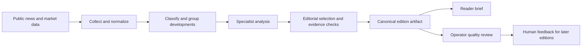

# Travel Market Intelligence for OTAs

**An architecture case study and runnable, fictional sample of an evidence-led travel intelligence system.** It turns public market developments into a short brief with traceable facts and conditional hypotheses for a multi-product online travel agency (OTA).


> **Portfolio disclosure:** Avenra Travel, the continent of Caelora, every supplier, event, number and source record in the sample are invented. The system described here is adapted from a separate private project. This repository is a public reference slice, not that project's source code, live pipeline, client data or measured business results.

## Why an OTA would use this

An OTA has to understand flight capacity and distribution, hotel supply, destination discovery and market inputs together. A news feed presents many facts, but leaves the reader to work out which ones touch their product catalogue and what remains uncertain. This system is designed to produce a brief that answers three questions:

1. **What changed?** A factual headline tied to a dated source.
2. **Why might it matter?** A conditional chain from a market change to a specific OTA product line.
3. **What evidence is missing?** The conditions that could strengthen or weaken the hypothesis.

It does not use booking, customer or sales data, and it does not prescribe commercial actions. [The OTA value map](docs/ota-benefits.md) explains the questions it helps analysts frame across product lines.

## How I designed the system



The underlying private system uses local scheduled collection, structured article storage, model-assisted specialist analysis and editorial selection. A canonical edition artifact feeds deterministic reader and quality-control renderers, so the two views share the same facts. Quality checks cover source dates, headline centrality, duplicate developments, line balance and source-to-claim traceability. See [architecture](docs/architecture.md), [engineering notes](docs/engineering.md) and [editorial workflow](docs/workflow.md) for the design decisions.

| Design decision | Why it matters |
| --- | --- |
| Keep source records and dates attached to claims | The reader can inspect the reported fact behind a headline. |
| Separate observation from hypothesis | A plausible OTA effect is not presented as a market fact. |
| Model demand, supply, price and distribution links | An implication names the mechanism and its limits. |
| Resolve the same development across sources and editions | Repeated coverage does not become a false new signal. |
| Render reader and quality views from one artifact | Editorial review can inspect evidence without crowding the brief. |
| Require flight and hotel representation | One product line does not disappear because another has louder news. |

The [scope and limitations](docs/limitations.md) page distinguishes this public reference from the private implementation.

## Run the fictional sample

The sample OTA, **Avenra Travel**, is assumed to sell flights, hotels and premium stays, destination experiences and partner distribution in fictional Caelora.

```bash
python3 examples/build_demo.py
```

That offline, standard-library script reads a synthetic fixture, validates it, ranks candidate signals and writes `examples/sample_brief.html`. Open that file, or open the [interactive mockup](examples/interactive-demo.html) directly in a browser. The interactive mockup includes flight and hotel signals, opportunity-radar hypotheses, and an embedded fictional source ledger. The script is deliberately a small illustration of the workflow, not a copy of the private production algorithm.

Read the [sample case](docs/sample-case.md) and [example guide](examples/README.md) for the signal logic and files.

## Repository map

```text
docs/       architecture, workflow, OTA value, sample case and limitations
examples/   synthetic input, small offline builder and sample HTML views
assets/     screenshot of the fictional reader brief
```

## What this demonstrates

This repo makes the system's reasoning and presentation inspectable: a compact cross-product brief, a source trail, a conditional implication and an explicit boundary between automation and human judgment. It claims no revenue lift, conversion gain, deployment at Avenra or verified market event in Caelora.
