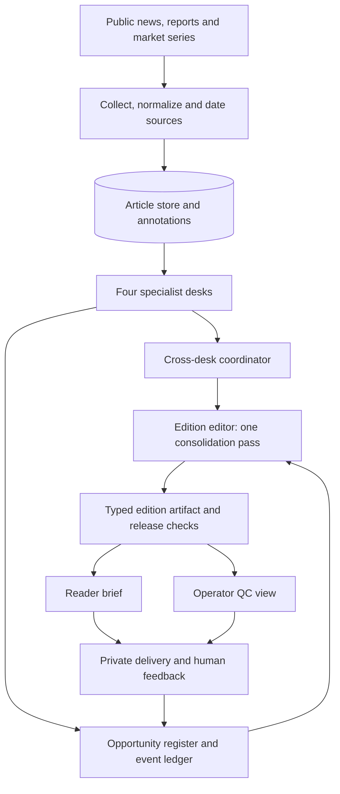
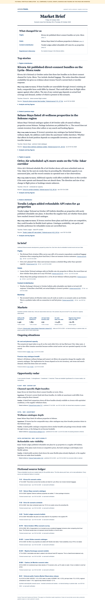

# Travel Market Intelligence for OTAs

**A multi-agent AI architecture case study with a runnable, fictional data-pipeline sample.** The implemented private system turns public market developments into an OTA brief with traceable facts and conditional hypotheses. This portfolio shows where model judgment enters that workflow and which checks remain in code.

**My role:** I designed and built the source-to-edition pipeline, the bounded AI desk/editor handoffs, cross-edition opportunity state, evidence and release checks, and the reader/QC output path. This repository presents a sanitized design and a smaller executable reference, with the boundaries stated below.

**[See the complete sample brief below](#complete-sample-brief)** · [Open the HTML edition](examples/interactive-demo.html)

> **Portfolio disclosure:** Avenra Travel, the continent of Caelora, every supplier, event, number and source record in the sample are invented. The system described here is adapted from a separate private project. This repository is a shareable reference slice, not that project's source code, live pipeline, client data or measured business results.

## One design decision in 60 seconds

The fictional edition has **six source records**. Two report the same Kivora flight-bundle announcement, one older hotel record falls outside the edition window, and the reader ends with **four Signals** across flights and hotels. The reference pipeline stores both Kivora sources but creates one development; its QC shows the duplicate and the excluded record.

Why lead with Kivora's **three bundles** when another carrier reports **14% more seats**? A possible channel-specific offer difference is closer to an OTA's flight-comparison product than a capacity change whose fare effect still depends on operated seats and demand. The brief states that as a **conditional hypothesis**: it would weaken if a dated public comparison showed equivalent bundles in Avenra's offers. The illustrative score is inspectable in code; it is not a measured business outcome or the private editor's ranking method.

This is the design problem I worked on: turn external facts into a short, source-traceable multi-product brief while preventing duplicate events, unsupported implications and missing product lines. [Follow the complete source-to-brief case](docs/sample-case.md) and [the engineering decisions and tradeoffs](docs/design-decisions.md).

## Where AI is used

The private pipeline is an **orchestrated set of bounded model calls**, each with a specific input and structured handoff. A shared Claude CLI adapter handles those calls; the scheduled pipeline does not let the model browse for evidence.

| AI stage | What it receives | What it produces |
| --- | --- | --- |
| Article classifier | Collected public article text, taxonomy and active situations | Desk routing, topic/entity labels, urgency and confidence |
| Four specialist desks | Bounded, dated sources plus a travel-market causal map and relevant context | Candidate factual stories, conditional `so_what`, opportunity hypotheses, evidence references and falsifiers |
| Cross-desk coordinator | The desks' candidate facts | AI flags possible factual contradictions; code checks unconsumed handoffs. It does **not** select the brief |
| Opportunity matching | New candidate events and prior threads | A judgment on ambiguous same-versus-new developments; code persists event and revision state |
| Edition editor | Desk candidates, source metadata, prior editions and opportunity context | **One** structured editorial selection with factual headlines, source-linked facts and reader narrative |
| Knowledge maintainer | Accepted edition and touched entity records | Draft updates to narrative entity pages after the edition; it cannot rewrite the brief |

Code controls collection, source IDs, SQLite state, date windows, schema and citation validation, duplicate/release checks, ranking adjustments and rendering of reader/QC views. The model proposes analysis and editorial choices within those boundaries; humans make commercial decisions. **[Inspect the sanitized agent config and prompt excerpts](agent_specs/README.md)** to see the instructions and JSON handoffs; the [AI workflow trace](docs/ai-workflow.md) explains their order and failure behavior.

## Run the data pipeline

The executable reference slice lets you inspect the engineering path behind an edition. It uses **Python, SQLite and local fictional source fixtures**; it needs no account, model, network connection or external package.

```bash
python3 reference_pipeline/run.py --output reference_pipeline/output
python3 -m unittest discover -s reference_pipeline/tests -v
```

The first command writes a normalized `sources.sqlite` store, a canonical `edition.json`, a generated `reader.html` and an operator `qc.html`. Replaying the same fixture keeps the source row count and rendered artifact bytes stable. The five tests cover idempotent replay, two-source development grouping, provenance and date rejection, flight/hotel release coverage, and visible source lineage. [Open the reference pipeline guide](reference_pipeline/README.md), [data contracts](docs/data-contracts.md) and [engineering notes](docs/engineering.md) for inputs, controls and limits.

The [complete visual brief](#complete-sample-brief) is a separate, curated portfolio example. The generated reader is deliberately simpler; this repository does not claim that the offline slice implements the private system's agents, cross-edition memory, model calls or delivery.

## Why an OTA would use this

An OTA has to understand flight capacity and distribution, hotel supply, destination discovery and market inputs together. A news feed presents many facts, but leaves the reader to work out which ones touch their product catalogue and what remains uncertain. This system is designed to produce a brief that answers three questions:

1. **What changed?** A factual headline tied to a dated source.
2. **Why might it matter?** A conditional chain from a market change to a specific OTA product line.
3. **What evidence is missing?** The conditions that could strengthen or weaken the hypothesis.

It does not use booking, customer or sales data, and it does not prescribe commercial actions. [The OTA value map](docs/ota-benefits.md) explains the questions it helps analysts frame across product lines.

## System architecture



The underlying private system uses local scheduled collection, SQLite article and cross-edition state, model-assisted specialist analysis and one editorial selection pass. A typed edition artifact feeds deterministic reader and quality-control renderers, so the two views share the same facts. Quality checks cover source dates, headline centrality, duplicate developments, line balance and source-to-claim traceability. The [architecture deep dive](docs/architecture-deep-dive.md) maps the stores, contracts, release gates and failure paths; [engineering notes](docs/engineering.md) and [editorial workflow](docs/workflow.md) explain the design decisions.

## Agents and orchestration

The implemented edition runtime can invoke **up to four enabled specialist desks**, a cross-desk check, opportunity-memory stages and **one edition-editor pass**. It is a bounded workflow with typed handoffs, not dozens of independent agents running freely.

| Role | Owns | Handoff |
| --- | --- | --- |
| Macro and policy desk | FX, energy, policy and ongoing disruptions as travel demand or cost drivers | Dated context and candidate signals |
| Aviation desk | Routes, capacity, fares and air-content distribution | Flight developments and content hypotheses |
| Stay and experiences desk | Hotels, premium stays, destinations and experiences | Stay developments and product-fit hypotheses |
| Distribution and competition desk | OTA channels, travel technology, metasearch and new interfaces | Cross-product channel developments |
| Coordinator | Cross-desk forwards and conflicting factual claims | Alerts and a consistency report |
| Opportunity memory | Earlier signals and event threads | New-versus-existing evidence and radar candidates |
| Edition editor | Selection, ranking and reader narrative | One canonical edition artifact for deterministic validation and rendering |

Classification, situation tracking, entity roles, text measures, health checks and the knowledge maintainer surround that core flow. Some use a model through a shared adapter; others are deterministic. The [agent roster](docs/agents-and-orchestration.md) and [AI workflow](docs/ai-workflow.md) distinguish every role, handoff and rollout state.

## How an opportunity is reasoned about

An opportunity starts with a **dated, source-supported event**. A company-specific `so_what` traces the event through a demand, supply, price or distribution mechanism to an assumed OTA product exposure. A separate Radar hypothesis records what later observation would **falsify** that reading. The editor can route a candidate to a full Signal, a short factual note, Radar, or operator-only review; a falsifier's presence alone does not earn a Radar card.

```text
source fact → market first mover → transmission channel → OTA exposure
            → conditional so_what → testable falsifier → later evidence/revision
```

The [opportunity reasoning guide](docs/opportunity-reasoning.md) provides the decision matrix, evidence limits and an annotated Avenra case. The [offline fixture](examples/fixture.json) and [small builder](examples/build_demo.py) make the first mover, channel, assumed exposure, missing evidence and falsifier inspectable in code. The [reference pipeline](reference_pipeline/README.md) separately demonstrates source ingestion, lineage and release checks. These examples illustrate selected contracts; the full cross-edition ledger and editorial gates remain in the private implementation.

| Design decision | Why it matters |
| --- | --- |
| Keep source records and dates attached to claims | The reader can inspect the reported fact behind a headline. |
| Separate observation from hypothesis | A plausible OTA effect is not presented as a market fact. |
| Model demand, supply, price and distribution links | An implication names the mechanism and its limits. |
| Resolve the same development across sources and editions | Repeated coverage does not become a false new signal. |
| Render reader and quality views from one artifact | Editorial review can inspect evidence without crowding the brief. |
| Require flight and hotel representation | One product line does not disappear because another has louder news. |

The [design decisions](docs/design-decisions.md) explain why these checks exist and what they cost. The [scope and limitations](docs/limitations.md) page distinguishes this portfolio reference from the private implementation.

## Complete sample brief

The sample OTA, **Avenra Travel**, is assumed to sell flights, hotels and premium stays, destination experiences and partner distribution in fictional Caelora.

The full reader edition is displayed below. It contains:

| Reading layer | What the sample shows |
| --- | --- |
| **What changed for us** | A four-line scan across flights, hotels, distribution and discovery, with links to the leading stories. |
| **Top stories** | Four ranked, source-linked developments with a factual headline, what changed, a conditional OTA implication and expandable analysis. |
| **In brief** | Shorter developments grouped by flight, hotel, distribution and backdrop. |
| **Markets** | A dated, explicitly fictional FX, cost and travel-indicator strip. |
| **Ongoing situations** | Two continuing themes connecting recent evidence without treating a one-off event as a trend. |
| **Opportunity radar** | Three hypotheses, each with a factual event, falsifier and dated evidence. |
| **Source ledger** | Nine embedded fictional records so every sample claim can be traced without presenting invented sources as real publications. |



Open the [HTML edition](examples/interactive-demo.html) to use its story and source links and expand the analysis notes. The screenshot shows the entire brief, including the source ledger; all names, places, events, sources and figures are synthetic.

### Inspect the small brief builder

To inspect a second, smaller illustration of opportunity fields and brief rendering, run:

```bash
python3 examples/build_demo.py
```

That standard-library script reads a synthetic fixture, validates it, ranks candidate signals and writes [a compact generated brief](examples/sample_brief.html). The [reference pipeline](reference_pipeline/README.md) above is the primary runnable data-engineering example. The Avenra Market Brief is the portfolio's full reader sample; neither generated page is a copy of the private production algorithm.

Read the [sample case](docs/sample-case.md) and [example guide](examples/README.md) for the signal logic and files.

## Repository map

```text
docs/       case study, design decisions, AI handoffs, architecture and limits
agent_specs/   sanitized config and prompt excerpts for classifier, desks, coordinator, matcher and editor
reference_pipeline/   fictional sources, SQLite pipeline, tests and generated views
examples/   synthetic opportunity input, small builder and curated HTML brief
assets/     screenshot of the fictional reader brief
```

## What this demonstrates

This repo makes the system's reasoning and presentation inspectable: a compact cross-product brief, a source trail, a conditional implication and an explicit boundary between automation and human judgment. It claims no revenue lift, conversion gain, deployment at Avenra or verified market event in Caelora.
