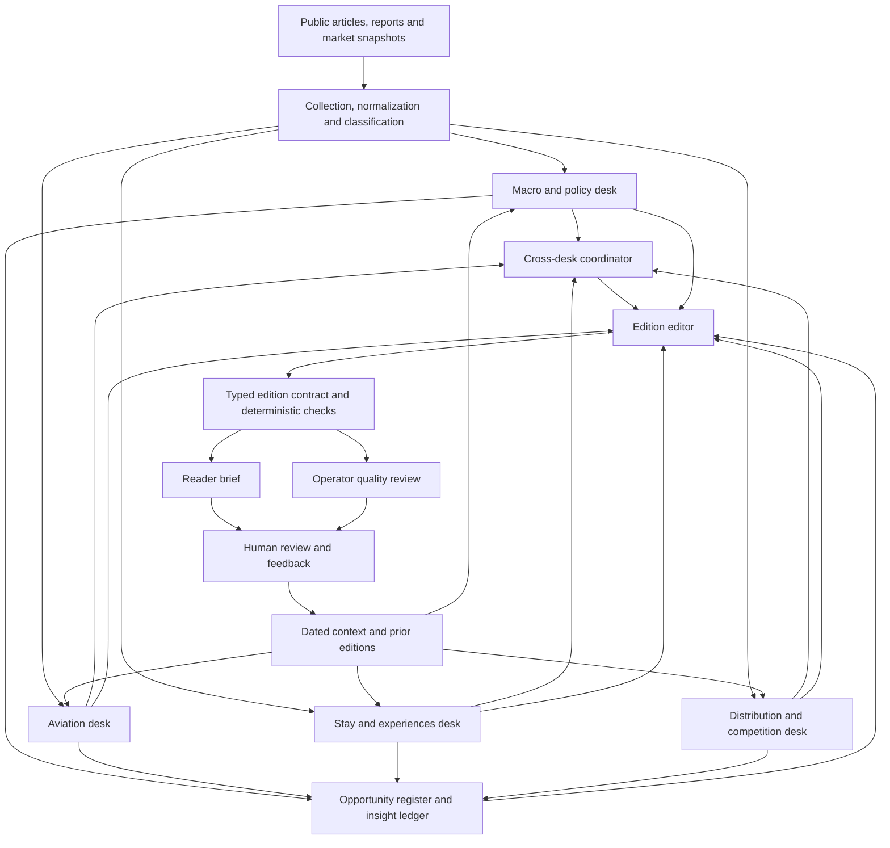

# Agents and orchestration

This page describes the **implemented private system** at a shareable level. The fictional Avenra example in this repository is a small offline illustration. It does not execute the model-assisted agents, persistent stores or delivery chain described here.

## Runtime map

The four desks are bounded model-assisted analysis roles, invoked in sequence once per edition when enabled. A disabled desk emits a typed disabled record without a model call. The desks do not browse the web during the scheduled run; they reason over collected, dated material. The coordinator and editor have distinct jobs: the coordinator checks agreement across desks, while the editor decides what enters the edition. A schema-validated artifact and code-level checks sit between model output and publication. [The AI workflow map](ai-workflow.md) lists every principal model handoff and a fictional source-to-brief trace.

## The four analysis desks

| Desk | Questions it owns | Candidate output |
| --- | --- | --- |
| **Macro and policy** | How could currency, fuel, policy or an ongoing disruption change travel demand, supply or cost? | Dated context and evidence-backed macro or policy signals. Macro context can remain brief without a company-specific implication. |
| **Aviation** | What changed in routes, capacity, fares, carriers or air-content distribution? | Flight stories and content-availability hypotheses with their conditions. |
| **Stay and experiences** | What changed in hotel supply, premium stays, destination demand or experiences? | Hotel and experience stories, including source-specific claims and conditional product-fit hypotheses. |
| **Distribution and competition** | How are travel products being sold through OTAs, metasearch, APIs or new interfaces? | Channel and competitor developments, including effects that may cut across flight and hotel. |

Each desk returns a typed output with top stories, opportunity candidates, evidence references, confidence and dated context. A candidate hypothesis identifies what observation would weaken it. Desks can forward an item to another desk; the receiving desk consumes it on a later edition, and the coordinator checks whether that handoff was used.

## Coordination, editorial judgment and memory

| Component | Model-assisted work | Deterministic work and boundary |
| --- | --- | --- |
| **Article classifier** | Assigns article-level market and topic labels from collected text. | The intake path retains the source record and date. Classification alone does not make a reader signal. |
| **Cross-desk coordinator** | Looks for conflicting figures or incompatible accounts across desk outputs. | Verifies cross-desk forwards and records alerts. It does not select the final stories. |
| **Opportunity register** | Helps match uncertain candidate signals to earlier hypotheses. | Maintains cross-edition signal history and the edition's change summary. |
| **Insight ledger** | Resolves uncertain matches between a new event and an existing thread when needed. | Tracks event → thread → revision → evidence, checks identity and novelty, and projects a testable radar view. |
| **Edition editor** | Makes one editorial pass over desk candidates and ledger context: selects, consolidates and writes the reader narrative. The same pass supplies ledger materiality decisions. | Subsequent code validates the typed artifact, source ownership, dates, novelty, ranking and flight/hotel representation. Reader and QC pages are rendered deterministically. |
| **Knowledge maintainer** | Refreshes narrative portions of touched entity pages after an edition. | Structured appearances, links and indexes are generated from stored evidence. Maintenance is downstream of delivery and cannot rewrite the edition. |

The system also runs narrower supporting stages for situations, travel-policy monitoring, entity roles, text measures and tracked hypotheses. Some combine model judgment with rules; others are deterministic. They are inputs or checks around the four desks, not additional independent edition editors.

The persistent insight ledger and an earlier opportunity register currently coexist. The ledger defaults to a shadow path without a rollout switch; the controlled rollout uses its reader projection for scheduled editions. The hosted application's global radar projection is still held separately during that rollout. This distinction matters when describing which output is live and which is under evaluation.

## One edition, step by step

1. **Prepare dated evidence.** A local collection run gathers public material, normalizes it and updates article, market and situation state.
2. **Produce desk candidates.** Four specialist desk calls receive bounded source excerpts and dated context. Their outputs are validated against a common contract.
3. **Cross-check and reconcile.** The coordinator checks handoffs and contradictions; the opportunity register and ledger compare candidates with earlier editions.
4. **Edit once.** A single edition-editor call selects the portfolio and writes source-linked facts and conditional implications.
5. **Apply release checks.** Code checks the edition window, duplicate developments, headline support, evidence quality and central flight/hotel coverage before finalizing the artifact.
6. **Render two views.** The canonical artifact produces a reader brief and a separate operator QC view. The reader sees the complete brief; the operator sees confidence, provenance and failures.
7. **Deliver and learn.** Delivery status is checked. Human feedback can inform later editions, while the accepted edition remains a recoverable record.

This is a **bounded workflow**, not a free-roaming swarm. Model calls operate within typed inputs and outputs; code controls timing, state, gates and publication. The human reader owns commercial decisions.
