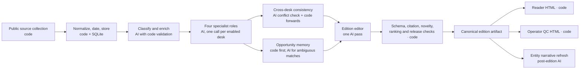

# Where AI works in the multi-agent system

This page describes the **implemented private pipeline** at a shareable level. Its production source code, company-context prompts, real input corpus and model credentials are not in this portfolio. [Sanitized agent configuration and prompt excerpts](../agent_specs/README.md) show the role and handoff contracts using fictional Avenra context. The executable [`reference_pipeline/`](../reference_pipeline/README.md) demonstrates source, SQLite, lineage and rendering controls with invented data; it makes **zero model calls**. The [complete Avenra brief](../examples/interactive-demo.html) is a separately curated fictional reader example.

## The execution path

The orchestration is sequential and bounded. Four desk **roles** are configured; a disabled desk emits a typed disabled record without calling the model. The enabled desks receive their own source sets and return structured candidates. They do not publish independently, and a cross-desk forward is consumed by its target on a later edition. There is one editor call for the edition, followed by code-level validation and rendering.

## What each model call is for

| Stage | Bounded input | Model judgment | Parsed handoff and code boundary |
| --- | --- | --- | --- |
| Classifier | Article title/snippet, taxonomy and active situations | Route to primary/secondary desks; tag entities, themes, urgency and confidence | Structured classification checked against known article IDs; low-confidence records go to review. |
| Entity-role enrichment | Ambiguous names with title/lead/mention context | Distinguish an entity's role in a reported event | Deterministic rules handle clear cases; malformed model output falls back. |
| Situation tracker | Tagged public developments and dated market state | Summarize what changed in an ongoing situation | Dated situation record; it supplies context, not a new unsupported fact. |
| Four specialist desks | Each desk's bounded dated articles, source references, travel-market map and relevant context | Identify candidate stories and a causal chain: first mover → demand/supply/price or distribution channel → possible OTA exposure; draft evidence and falsifier | Typed desk output with source references, confidence and optional cross-desk forwards. Code rejects invalid stories or unknown citations. |
| Cross-desk coordinator | The desks' candidate facts | Flag genuine contradictory values, accounts or double-counted developments | A coordination report and operator alerts. Code separately checks whether prior forwards were consumed. The coordinator does not pick final stories. |
| Opportunity register and event ledger | Candidate event against earlier hypothesis/thread state | Judge **ambiguous** same-versus-new matches and possible thread updates | Code performs clear matches, persists event/thread/revision state and keeps unresolved cases visible for review. The newer ledger has a controlled reader rollout; it is not the sole live radar path everywhere. |
| Edition editor | Desk candidates, source metadata, situation and opportunity context, recent editions | Select and consolidate stories; write factual headline and `what_changed`, conditional `so_what`, source-linked facts and editorial materiality verdicts | One structured edition proposal. Code validates the artifact, checks source ownership, dates, novelty and central flight/hotel coverage, adjusts ranking and renders both views. |
| Post-edition knowledge maintainer | Accepted edition and touched entity records | Refresh narrative portions of entity pages | Structured appearances, links and indexes remain evidence-derived; a maintainer failure cannot rewrite or block the finished edition. |

Supporting model stages also extract or summarize selected policy/surcharge information and update tracked hypotheses when new evidence meets their triggers. They are **not** extra autonomous edition editors. Deterministic collection, text measures, scoring, health probes, rendering and delivery surround these calls.

The shared model adapter owns provider invocation, response/usage logging and retry of transient backend failures. Callers own JSON extraction and contract validation. Scheduled calls use the configured Claude CLI without model web browsing; the evidence set comes from collected public material. A broad classifier failure triggers a dependency check before desk work, while a failed desk or invalid final artifact can stop an edition. Noncritical enrichment can degrade with operator visibility.

## Fictional handoff trace: Kivora bundles

This trace **illustrates the contracts** with invented Avenra data. It is not a captured model response and did not run through the private AI pipeline.

| Handoff | Example content | Boundary |
| --- | --- | --- |
| Source intake | `F-01`: Kivora Air scenario notice, 27 Oct 2026, lists three Lyria–Mora bundles, two with baggage. `F-01B`: fictional trade report dated 28 Oct on the same development. | Code retains both source IDs and dates. These are invented records, not real citations. |
| Classifier → desk | `primary_desk: aviation`; `secondary_desks: [distribution-competition]`; entities and confidence attached to known source IDs. | An invented or mismatched article ID is rejected. |
| Aviation desk → candidate | Factual event: bundle announcement. Conditional mechanism: channel-specific supply → potential offer difference **if** comparable bundles are absent from Avenra's public offers. Falsifier: a dated offer comparison shows equivalent bundles. | A source fact and a possible OTA effect occupy separate fields. |
| Cross-desk coordinator | Check whether aviation and distribution describe the same bundle terms consistently; record a forward for later distribution review if needed. | No second Signal is created just because two desks discuss one event. |
| Opportunity memory | Match the event to an existing bundle-access thread if evidence supports it; otherwise create or leave an uncertain candidate for review. | Thread identity and novelty are state decisions, not prose similarity alone. |
| Edition editor → artifact | Factual headline: “Kivora Air published direct-connect bundles on the Lyria–Mora route.” `what_changed` cites the bundle count; `so_what` remains conditional; source refs retain `F-01` and `F-01B`. | The editor proposes inclusion; code checks citations, edition window, duplicate development, line balance and artifact shape. |
| Reader and QC | Reader shows the source-linked observation and hypothesis. QC shows evidence limits, match uncertainty and any failed checks. | Both views project the same accepted edition; neither renderer makes another AI call. |

The [`reference_pipeline/` fixture](../reference_pipeline/fixtures/sources.json) contains the two Kivora source records and demonstrates deterministic grouping and source lineage. Its score and generated reader are intentionally simpler than the private editorial process.
