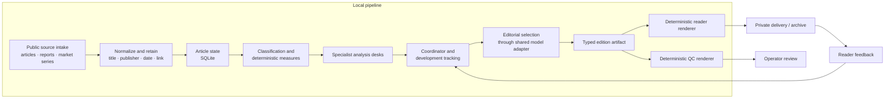
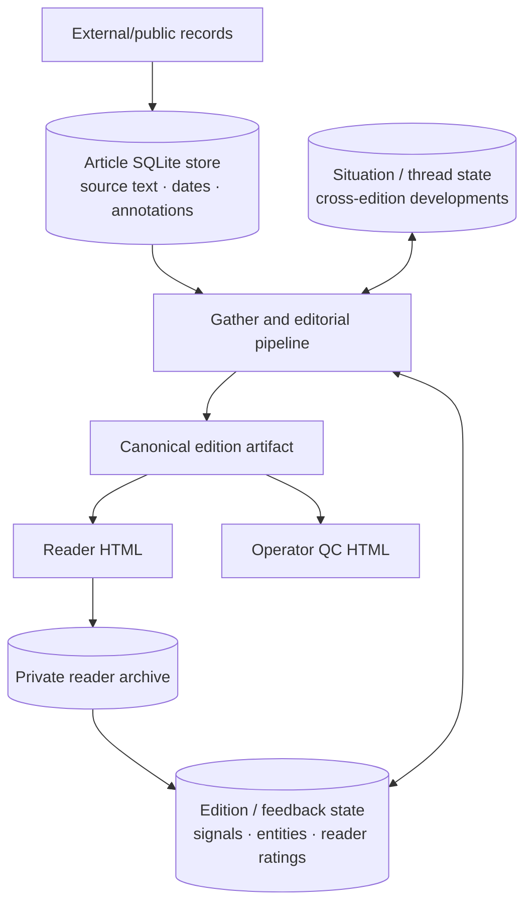
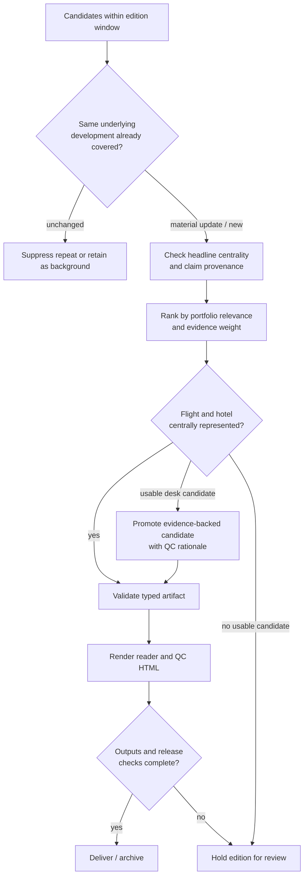

# Architecture deep dive

This document describes the **implemented system pattern** behind this portfolio at a public-safe level. The portfolio itself is an **offline simulation** for Avenra Travel, a fictional OTA on the fictional continent of Caelora. It contains no production source corpus, private business data, credentials, delivery setup, hosted application, or measured customer result. The [runnable reference pipeline](../reference_pipeline/README.md) and [curated brief](../examples/README.md) illustrate selected contracts; neither implements the model-assisted architecture below. The [AI workflow map](ai-workflow.md) shows the model-call boundaries.

## System boundary

The full system is a scheduled, local source-to-brief pipeline with a separate private reading application. Collection and model-assisted work remain local. After an edition is validated and rendered, the reader surface can receive the finished artifact. The design ingests external/public travel information and does not require booking, customer, lead or internal sales data.

The arrows show logical dependencies. Operational stages may run on different cadences: collection and normalization can update more often than the reader edition. A failed noncritical collection stage can leave the latest usable material available to downstream stages, while a failure in the analysis or artifact build path can prevent that edition from being released.

The underlying design documents use an intelligence-organization metaphor with many possible analytical roles. That is a **conceptual responsibility map**, not a claim that dozens of autonomous model agents run per edition. The implemented reader pipeline groups work into four specialist desks, a coordination stage and one editorial consolidation pass, alongside deterministic processing and validation.

## Component responsibilities

| Component | Input | Responsibility | Durable output or consumer |
| --- | --- | --- | --- |
| Intake and normalization | External/public articles, selected reports and market observations | Preserve original provenance; split bundled items where appropriate; deduplicate source records | Article store |
| Classification and measures | Normalized articles | Assign product/market context and compute deterministic text or entity signals | Article annotations |
| Specialist desks | Dated, bounded article sets and market context | Form candidate developments and conditional analyses for air, stays, distribution and macro context | Desk candidate records |
| Coordinator and development tracking | Desk candidates plus earlier edition state | Resolve overlap, forwards and relationships to already covered developments | Coordinated candidates and thread state |
| Editorial builder | Candidate developments, context and feedback | Select and rank an edition; separate observable facts from implications; enforce product-line coverage and evidence checks | Canonical typed edition artifact |
| Reader and QC renderers | Same validated artifact | Produce the complete reader brief and a separate operator-facing quality view | Two HTML outputs |
| Delivery and private application | Rendered edition | Distribute and archive the approved reader artifact; collect reader feedback | Private reader access and feedback state |
| Health and observability | Stage results, dependency probes and delivery receipts | Distinguish degraded input coverage from a missed edition; surface failures | Logs, alerts and review notes |

This separation matters because model-generated prose is an **input to validation**, while the rendered reader page is a deterministic projection of a validated edition object. A renderer does not have to reinterpret source material or make a second editorial decision.

## Data and state

The article store supports source-level provenance and classification. Cross-edition stores support novelty checks, ongoing situation or opportunity threads, and human feedback. The canonical artifact is an edition snapshot: it preserves what was selected and rendered for that run, rather than relying on mutable stores to reconstruct the page later. The private application stores a published copy for reading; it is not where collection or editorial analysis runs.

A newer event → thread → revision ledger is evaluated alongside the earlier tracking path. With no rollout switch, it runs in **shadow mode** and records a projection without changing the reader edition. The current controlled rollout uses **reader mode for the scheduled edition's radar and lower-priority routing**, with stricter failure handling. The application-wide radar projection remains in shadow mode. This distinction is about the present rollout state, not a promise that every surface has switched to the new ledger.

The portfolio has two separate synthetic examples: `reference_pipeline/` ingests six source records into SQLite and generates an edition JSON plus simpler reader/QC HTML; `examples/` contains a small opportunity builder and a richer curated brief. Neither runs the private agents or uses real source records.

## Edition contract

At the centre of the implemented design is a typed edition object. Its major reader-facing parts include edition metadata and coverage window, canonical facts, ranked signals, ongoing situations, an opportunity radar, and short lower-priority items. It also carries operator-facing quality and coverage fields. The reader and QC pages consume the same object but expose different fields.

A signal keeps these concerns distinct:

1. **Headline and “what changed”:** a source-supported, observable development.
2. **Source and fact references:** the original publisher, title, date and link for each real-world factual claim.
3. **Conditional implication:** an explicitly limited demand, supply, price or distribution transmission chain for the OTA's product stack.
4. **QC metadata:** confidence, coverage and evidence limitations for operator review, separate from reader copy.

The opportunity radar is a related but different contract: it can retain an event title, a hypothesis, a falsifier, change state and dated evidence. That structure lets a reader inspect how a thread changed without turning a possibility into a reported fact. A background or macro item can remain a factual brief without a company-specific implication.

## Editorial and release checks

These checks address different failure modes. Date bounds prevent a later article from entering an earlier coverage window. Novelty checks distinguish a new development from another outlet repeating the same event. Headline centrality asks whether the source is actually about the claim in the title. Evidence weight limits promotion of thin or incidental mentions. Product-line coverage keeps both flight and hotel visible when usable material exists. None of these checks supplies missing facts; an ungrounded candidate cannot be repaired by more fluent writing.

The full brief is inline in the reader HTML. Operator-facing notes about evidence breadth, release checks and coverage are placed in the QC view rather than in a reader-facing “action” or “watch” instruction. Human readers make commercial decisions.

## Reliability model

The system has two broad failure classes:

- **Degraded inputs:** a source is quiet, a collector fails, or a noncritical enrichment stage is unavailable. The pipeline records the issue and may continue with usable, dated inputs. A quiet source and a broken dependency are reported differently.
- **Edition-blocking failures:** the analysis stage cannot produce usable candidates, the typed artifact cannot be built, a required reader or QC render fails, or a release check finds no usable central flight or hotel story. The edition is held rather than silently sent.

Dependency health is checked before expensive downstream work when classification results indicate a broad model failure. Stage logs and delivery receipts let operators distinguish “process exited” from “reader edition actually delivered.” A scheduled run still needs observation: offline tests validate code paths, while source availability, external authentication and delivery are operational conditions.

Publication follows artifact creation and rendering. The private reader application receives a rendered edition; a failure there is surfaced separately from the local brief build. The portfolio does not include or exercise any delivery mechanism.

## Fictional trace through the design

The example below uses a record created for this portfolio, not a real publisher or an actual market event.

| Stage | Illustrative record |
| --- | --- |
| Intake | Fictional source **F-01**, dated 27 Oct 2026, says Kivora Air listed three direct-connect bundles for Lyria–Mora; two include baggage. |
| Normalization | Store the source title, date and exact stated facts. Label the record as flight/distribution and retain its fictional provenance. |
| Development check | Treat the bundle announcement as one development, rather than four separate claims or a repeated headline. |
| Analysis | Conditional chain: channel-specific bundle supply → possible offer difference → possible flight comparison effect **if** Avenra lacks those bundles. |
| Editorial selection | Headline the supplier's observable announcement; keep unknown feed coverage and demand out of the factual headline. |
| Artifact and render | The reader signal links to F-01 and shows its as-of date. A QC view could record missing catalogue comparison as an evidence limit. |
| Radar thread | Hypothesis: a channel-specific content gap may exist. Falsifier: a dated feed comparison shows equivalent bundles already available. |

This trace demonstrates the boundary between a **fictional source statement** and a **conditional interpretation**. The [AI workflow trace](ai-workflow.md#fictional-handoff-trace-kivora-bundles) shows the agent handoffs in more detail. The public reference pipeline demonstrates source storage and selected release controls without executing the model-assisted analysis; the small builder in `examples/` illustrates opportunity fields and ranking.

## Portfolio boundary

The documented architecture is a pattern derived from an implemented private project. This shareable portfolio is deliberately narrower: synthetic inputs, a runnable offline SQLite pipeline, a small opportunity builder, a curated reader page and explanatory documents. It excludes the production codebase, model integration, actual source list, operational identifiers, credentials, private URLs, delivery configuration, internal business context and real edition artifacts. Its value is the inspectable design of provenance, agent handoffs, editorial contracts and reader presentation, not a claim of deployment for Avenra Travel.
