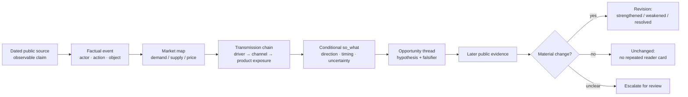

# How an opportunity is read

This document explains the **implemented private system's reasoning pattern** at a public-safe level. The worked example uses Avenra Travel, a fictional OTA on fictional Caelora, and invented source records. The [offline portfolio script](../examples/README.md) loads a fixture, applies a small illustrative score and renders HTML; it does **not** implement the private system's opportunity ledger, model-assisted judgement, cross-edition matching or quality controls.

An “opportunity” here is a **testable reading of external evidence**, not a forecast of sales or a recommendation to act. The system has no booking, conversion or other internal operating data, so a development can support a hypothesis about a product line without proving a business outcome.

## From event to conditional implication



The factual event and the causal reading are different objects. A headline and “what changed” describe what a source centrally reported. A company-scoped *so_what* follows **observed driver → first market mover (demand, supply or price) → transmission channel → assumed OTA product exposure → directional effect and lag, when evidenced**. Distribution and cost inputs can be channels or drivers in that chain. It uses conditional language when a link depends on an unknown. A broad macro development can remain a brief factual backdrop with no company-specific *so_what*.

Priority is based on the combination of **business proximity** and **evidence quality**. Evidence weight considers breadth, depth and freshness. A directly relevant carrier channel or hotel catalogue change may rank above a large but remote industry statistic, but thin or incidental material loses weight. A source's title, date, kind and central subject help test whether the headline represents its main claim. Deterministic headline-centrality checks can warn and demote; numeric lint is warning-only. These are safeguards, **not a complete automated fact verifier**. The reader receives the source and as-of date for every factual claim; confidence and coverage caveats are available to the operator in a separate QC view.

## Candidate routing: is there enough logic?

The private system makes two related editorial decisions: whether a development is a **Signal** in the brief, and whether a ledger candidate is material enough for **Radar**. These surfaces can overlap when the same external event is both a top story and the start or revision of a testable thread. A lower-priority “also worth knowing” item is a short factual awareness note; the same canonical development is not repeated there when it is already a Signal.

| Destination | Evidence and reasoning needed | Reader treatment |
| --- | --- | --- |
| **Signal** | Window-current, source-supported development with a central factual headline and enough evidence and portfolio relevance for a full reader story. Company-scoped Signals carry a defensible *so_what*; macro context can have none. | Headline, what changed, conditional implication when appropriate, source and date. |
| **Also worth knowing (AWK)** | Concrete, verifiable development worth awareness, but without a strong enough company-specific implication or full-story priority. | One concise factual note with its source; no invented OTA consequence. |
| **Opportunity Radar** | A concrete external event, direct or clearly evidenced OTA relevance, a stated causal mechanism, diagnostic evidence and a testable falsifier. All are required for the materiality verdict. | Factual event separated from hypothesis, falsifier, change state and dated evidence. |
| **Operator/QC only** | A candidate is too speculative, lacks a direct angle or diagnostic evidence, is a repeat with no material update, or cannot be judged safely. | Internal tracking, suppression or an ambiguity note. No reader card is invented to fill a slot. |

The matrix describes **decision criteria**, not a mechanical score in the portfolio script. The private editorial pass provides a verdict for each ledger candidate. Missing or inconsistent decision fields make that candidate ambiguous rather than defaulting it into Radar. Flight and hotel representation is checked separately at the edition level: a best usable desk item may be promoted last with its evidence limit recorded in QC, but the system does not invent a story or its evidence.

## Annotated fictional example

The example is entirely invented and can be inspected in the [sample brief](../examples/interactive-demo.html#story-1) and [fictional source F-01](../examples/interactive-demo.html#source-f01). It is not an actual airline announcement or a claim about a real OTA.

| Layer | Avenra scenario | Reasoning boundary |
| --- | --- | --- |
| Source statement | Fictional Kivora Air notice F-01, dated 27 Oct 2026: three direct-connect fare bundles on Lyria–Mora; two include checked baggage. | This is a **fictional source fact**, dated and linked to its embedded scenario record. |
| Factual event / headline | “Kivora Air published direct-connect bundles on the Lyria–Mora route.” | The title states the supplier's observable action. It does not claim sales, price movement or an Avenra content gap. |
| First mover | **Supply/distribution:** a carrier makes a set of fare bundles available on one channel. | The source supports channel availability; it does not establish availability on every seller channel. |
| Transmission chain | Channel-specific bundle supply → possible visible offer difference → possible flight comparison effect. | The middle link requires a public-facing offer comparison; it is not assumed. |
| Conditional *so_what* | If Avenra's public flight offers do not show equivalent bundles, comparison with sellers using that channel could differ. The magnitude depends on coverage and traveller demand. | This is a hypothesis about a possible product exposure, not a measured outcome or an instruction. |
| Falsifier | A dated public offer comparison shows equivalent bundles and conditions already visible for the same route and dates, or a later supplier notice withdraws the bundles. | A falsifier names an observable contrary result. It does not require private booking or customer data. |

The example deliberately stops before a commercial conclusion. A fare bundle announcement cannot by itself establish a missed booking, a price advantage, or a need to change suppliers. Those require evidence outside this fictional record.

The three prose layers have different jobs:

| Layer | Example wording | Status |
| --- | --- | --- |
| **Event fact** | “Kivora Air published three direct-connect bundles for Lyria–Mora; two include baggage.” | What fictional F-01 says, as of 27 Oct 2026. |
| **OTA *so_what*** | “If comparable bundles are absent from Avenra's public offers, its flight comparisons could differ by channel.” | Conditional effect of this event on an assumed OTA exposure. |
| **Radar hypothesis** | “Channel-specific bundles may create a persistent visible-content difference on this corridor.” | Cross-edition proposition that later evidence can strengthen, weaken or settle. |

An illustrative **reader projection** could look like this. It borrows public-facing field names from the private typed contract but is **not** a schema-valid production artifact or a real database record:

```json
{
  "event_title": "Kivora Air published direct-connect bundles on Lyria–Mora",
  "hypothesis": "If equivalent bundles are absent from Avenra's public offers, a visible flight-content difference could persist on this corridor.",
  "kill_condition": "A dated public offer comparison shows equivalent bundles and conditions, or Kivora withdraws the bundles.",
  "change": "new",
  "current_evidence": [
    {
      "source_title": "Kivora Air direct-connect fare bundles — fictional F-01",
      "as_of": "2026-10-27",
      "claim": "Three bundles listed; two include checked baggage."
    }
  ]
}
```

Here `event_title` is a factual title **within the fictional scenario**. `hypothesis` and `kill_condition` are analytical statements; the evidence row does not magically prove either. A real reader projection must resolve its evidence to actual external publishers and dates.

## Evidence boundaries

The implemented pattern applies several boundaries before a hypothesis reaches the reader:

- **Claim ownership:** a number or statement belongs to the source that actually reports it. A source link and as-of date travel with the claim; an internal label is not presented as a publisher.
- **Centrality:** the headline must be the source's main development, not a passing sentence inside an unrelated article.
- **Window and novelty:** a source outside the edition window can provide background, but cannot create a current development on its own. Another outlet repeating the same event does not make it new.
- **Causal scope:** the *so_what* connects one supported driver to a plausible product exposure. It does not fill missing links with imagined demand, inventory, partner terms or conversion.
- **Reader versus operator detail:** the reader sees the event, implication and source. Evidence breadth, confidence rationale, warnings and release checks stay in the QC view.
- **Public-only inputs:** neither the private pattern nor this portfolio needs internal booking, customer, sales or outreach data.

These boundaries are safeguards against two common errors: a factual headline that contains an analyst's conclusion, and a well-worded implication that outruns its evidence.

## Falsifiers and the thread lifecycle

The private system models an opportunity as an **event → causal thread → revision**. An event is a dated factual development. A thread holds a stable driver → mechanism → target-outcome hypothesis and, where present, a condition that would defeat or settle it. A revision records what later evidence changed. A single factual event can carry more than one analytical facet under the same causal thread; a shared topic alone is insufficient to merge distinct events.

| Result when later evidence arrives | Reader interpretation |
| --- | --- |
| **New** | A distinct, evidence-linked thread opens. |
| **Strengthened** | Genuinely material evidence advances a milestone, changes magnitude, independently confirms a claim with original reporting, or removes a stated uncertainty. A fresh URL or citation count alone is insufficient. |
| **Weakened** | A correction or contrary fact undercuts the mechanism or expected outcome. |
| **Resolved** | Evidence satisfies the thread's falsifier or otherwise settles the question. |
| **Unchanged** | The development is re-reported or adds no material information. It is retained for audit but not repeated as a new radar card. |
| **Ambiguous** | Matching or materiality cannot be established safely. The case is surfaced for operator review rather than merged or assigned a guessed status. |

The deterministic fast path can identify an entirely new thread or an exact re-citation of already known evidence. Genuinely new evidence for an existing thread is compared with its prior hypothesis and evidence by a bounded model-assisted judgement. Invalid or unavailable judgement escalates; it does not silently become “strengthened.” The resulting reader card separates the factual event title, hypothesis, falsifier and dated evidence so that an interpretation remains inspectable.

A written `kill_condition` is **a test for later evidence**, not an automatic fact-checker or a keyword trigger. A “resolved” state requires a dated, attributable development and a valid verdict with the required revision metadata. Merely finding similar wording in a new article does not kill the thread. A supporting report can also leave the state unchanged when it repeats an existing claim; a contradicting report can weaken the hypothesis without fully resolving it. The workflow preserves those distinctions instead of promising automatic resolution.

The newer ledger runs in **shadow mode by default**. During the current controlled rollout, the scheduled edition uses its **reader-mode** projection for opportunity radar and lower-priority routing, with stricter failure handling. The application-wide radar projection remains shadow-mode. The portfolio page is a hand-authored simulation of the reader shape; it is not a live projection from either mode.

## What the portfolio demonstrates

The [interactive example](../examples/interactive-demo.html#radar-title) shows three invented radar cards. Each exposes an event, conditional hypothesis, falsifier and dated fictional evidence. Their labels and numbers are scenario content, not observations about a real market. The example is useful for evaluating the **editorial contract**—whether a reader can move from source to fact to causal interpretation and see what would change the view—without claiming that this portfolio repository runs the private system.
